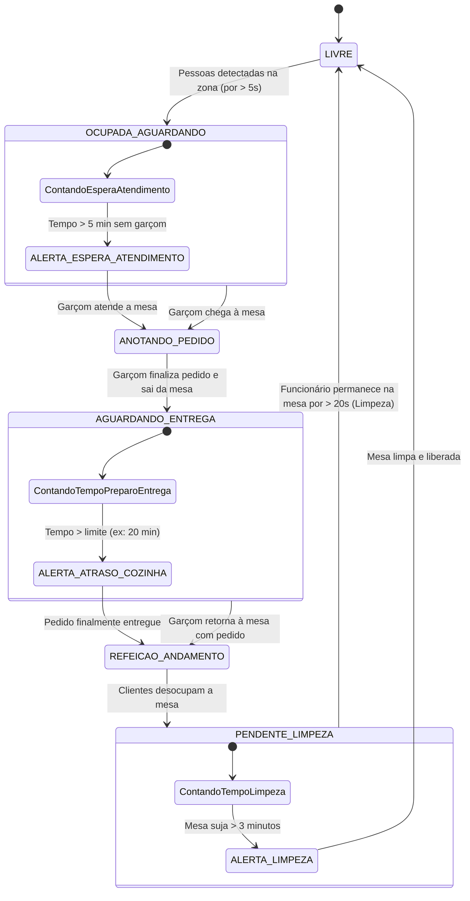

# 📋 Planejamento Estratégico e Arquitetura de Projeto
## Sistema de Monitoramento Inteligente de Mesas com Visão Computacional (IA)

---

### 1. Visão Geral e Objetivos do Produto

#### 1.1 Objetivo
Desenvolver uma solução escalável de Visão Computacional para restaurantes que monitore automaticamente o estado das mesas através de câmeras de segurança comuns (CFTV/RTSP), otimizando a experiência do cliente e o giro de mesas.

#### 1.2 Dores que o Sistema Resolve
* **Clientes esquecidos:** Reduz o tempo de espera inicial até a primeira abordagem do garçom.
* **Demora de cozinha/bar (Tempo entre Pedido e Entrega):** Monitora o tempo que a cozinha leva para preparar e o garçom entregar o pedido na mesa, evitando que pratos esfriem ou clientes fiquem insatisfeitos com a demora.
* **Gargalo no giro de mesas:** Detecta mesas vagas que ainda não foram limpas, acelerando a higienização para novos clientes.
* **Falta de dados operacionais:** Oferece ao gerente métricas reais de tempo médio de atendimento, tempo de cozinha/entrega, permanência e ociosidade das mesas.

---

### 2. Arquitetura da Solução (Modelo Híbrido: Edge + Cloud)

```
       [ Câmeras CFTV / RTSP ]
                  │
                  ▼
┌───────────────────────────────────────┐
│     Dispositivo Local (Mini PC Edge)  │
│                                       │
│  1. Ingestão RTSP (amostragem 2~5 FPS) │
│  2. Inferência YOLOv10 (Pessoas)      │
│  3. Rastreamento (ByteTrack)          │
│  4. Interseção Geométrica (Polígonos) │
│  5. Máquina de Estados & Cronômetros  │
│  6. Painel de Calibração Web Local    │
└──────────────────┬────────────────────┘
                   │ Apenas Metadados JSON (Eventos/Métricas)
                   ▼
┌───────────────────────────────────────┐
│  Nuvem / Dashboard Gerencial          │
│                                       │
│  - Painel do Gerente em Tempo Real    │
│  - Alertas (WhatsApp / Telegram)      │
│  - Relatórios e Histórico de Turnos   │
└───────────────────────────────────────┘
```

---

### 3. Máquina de Estados das Mesas (FSM)

Cada mesa cadastrada operará sob os seguintes estados e transições:



#### 3.1 As 3 Métricas Críticas de Tempo:
1. **Tempo de 1ª Abordagem:** Desde o cliente sentar até o garçom ir à mesa (meta: < 3 a 5 min).
2. **Tempo de Espera do Pedido (Cozinha/Entrega Real):** Desde a anotação do pedido até a comida de fato chegar à mesa (meta: configurável, ex: < 15 a 20 min).
3. **Tempo de Giro / Limpeza:** Desde a saída dos clientes até a mesa estar limpa e verde novamente (meta: < 3 min).

#### 3.2 Regra de Ouro: Distinção de "Talheres/Pratos Vazios" vs "Comida Chegando"
Em muitos restaurantes, o garçom leva talheres, copos, guardanapos ou pratos vazios (*mise en place*) logo no início, muito antes da comida ficar pronta. Se o sistema considerasse qualquer ida do garçom como "pedido entregue", geraria um falso positivo grave.

Para garantir que o cronômetro só seja encerrado na entrega real da comida, o sistema adota 3 filtros inteligentes:
* **Filtro 1: Janela Temporal Mínima de Cozinha (Anti-falso positivo):** Nenhuma cozinha entrega um prato quente em menos de 4 a 6 minutos após o pedido. Visitas do garçom antes dessa janela mínima são classificadas automaticamente como *Entrega de Talheres / Mise en place* ou *Bebidas*, mantendo o cronômetro do prato principal rodando.
* **Filtro 2: Tempo de Interação do Garçom:** Levar talheres é uma ação relâmpago (5 a 10 segundos). Servir a refeição principal envolve organizar travessas, pratos cheios e servir clientes (geralmente > 25 a 45 segundos).
* **Filtro 3: Mudança de Dinâmica da Mesa (Início da Refeição):** Após a entrega real da comida, a movimentação dos clientes muda bruscamente: postura inclinada para a mesa e movimento frequente de mãos/braços em direção ao prato por vários minutos consecutivos (atividade de alimentação). Se os clientes continuam na mesma postura de espera, a comida ainda não chegou.
* **Filtro 4 (Modo Integrado - Opcional):** Se integrado ao sistema de cozinha (KDS), a câmera só valida a entrega após a cozinha apertar o botão de "Prato Pronto / Expedição".

---

### 4. Módulos do Sistema

1. **Módulo de Ingestão e Conexão de Câmeras (`camera_stream`)**
   * Conexão resiliente a fluxos RTSP / ONVIF / Webcam com reconexão automática em caso de queda de rede.
   * Amostragem inteligente de frames (processamento a 2 a 5 FPS para economia drástica de CPU/GPU).

2. **Módulo de Calibração e Zonas de Interesse (`roi_calibrator`)**
   * Interface gráfica web intuitiva para congelar um frame da câmera.
   * Permite ao usuário clicar na tela e desenhar os polígonos que delimitam cada mesa e área de circulação.
   * Persistência das configurações em JSON/YAML.

3. **Módulo de Visão Computacional & Rastreamento (`vision_engine`)**
   * Carregamento do modelo **YOLOv10** (versão Nano/Small) sob licença permissiva Apache 2.0.
   * Identificação de classes de interesse (`person`).
   * Algoritmo de *tracking* contínuo (ByteTrack) para manter a identidade das pessoas e funcionários no vídeo.
   * Teste de inclusão de ponto em polígono (`cv2.pointPolygonTest` / Shapely).

4. **Motor de Regras, Temporizadores e Estados (`fsm_manager`)**
   * Monitoramento individualizado por mesa com múltiplos cronômetros paralelos.
   * Rastreamento da métrica de **Espera do Pedido (Cozinha/Entrega Real)** com filtros anti-falso positivo (não confunde entrega de talheres com a refeição).
   * Suporte a dois modos operacionais:
     * *Modo Autônomo (100% Câmera):* Inicia cronômetro após anotação do pedido; encerra somente após visita qualificada do garçom + confirmação do início da atividade de refeição dos clientes.
     * *Modo Integrado (Opcional - PDV/KDS):* Recebe webhook do sistema ao despachar o prato na cozinha, e a câmera valida visualmente a entrega na mesa.
   * Debounce temporal (filtros para evitar falsos positivos se alguém apenas passar caminhando em frente à mesa).

5. **Módulo de Notificações e Alertas (`alert_service`)**
   * Disparo multicanal configurável:
     * Alerta sonoro / pop-up na tela do caixa/gerência.
     * Webhook para bot de WhatsApp (ex: Evolution API / Z-API) ou Telegram.
   * Gatilhos de alerta:
     * Cliente esperando atendimento (> 5 min).
     * Cozinha/Entrega demorando (> tempo limite configurável, ex: 20 min).
     * Mesa desocupada pendente de limpeza (> 3 min).

6. **Dashboard Operacional e Histórico (`dashboard`)**
   * Mapa visual da planta do restaurante com indicadores em tempo real:
     * 🟢 Verde: Livre
     * 🔴 Vermelho: Ocupada aguardando 1º atendimento
     * 🔵 Azul: Aguardando entrega dos pratos (cronômetro da cozinha)
     * ⚠️ Amarelo piscante: Alerta de espera ou atraso de prato
     * 🟠 Laranja: Aguardando limpeza
   * Relatórios gerenciais:
     * Tempo médio de 1º atendimento.
     * Tempo médio de preparo/entrega da cozinha.
     * Tempo médio de higienização e taxa de giro das mesas.

7. **Empacotamento e Implantação Rápida (`deployment`)**
   * Contêineres Docker multi-plataforma via `docker-compose`.
   * Script automatizado de instalação em 1 linha para servidores Linux / Mini PCs.
   * Túnel seguro de acesso e suporte remoto (Tailscale).

---

### 5. Etapas de Execução do Projeto (Roadmap)

#### 📍 Fase 1: Planejamento, Arquitetura e Modelagem (Concluída nesta etapa)
- [x] Definição de escopo e arquitetura do sistema.
- [x] Escolha do modelo de IA (YOLOv10 com licença comercial livre Apache 2.0).
- [x] Estruturação da Máquina de Estados e regras de negócio.
- [x] Elaboração do documento oficial de planejamento (`PLANEJAMENTO.md`).

#### 📍 Fase 2: Prova de Conceito (PoC) com Vídeo Gravado (Concluída nesta etapa)
- [x] Configuração do ambiente de desenvolvimento Python 3.11 e dependências essenciais (`ultralytics`, `opencv-python`, `shapely`, `numpy`).
- [x] Obtenção de vídeo teste real de mesas (`data/videos/sample_restaurante.mp4` - 6.304 frames, 210s).
- [x] Script de teste e validação de inferência YOLOv10n (`src/test_yolo.py`) com detecção de pessoas em tempo real.

#### 📍 Fase 3: Ferramenta de Calibração de Zonas (Concluída nesta etapa)
- [x] Desenvolvimento da ferramenta interativa de polígonos em OpenCV (`src/calibrador_mesas.py`).
- [x] Mapeamento e calibração das 5 mesas do salão de teste (`src/gerar_calibracao.py`).
- [x] Exportação e persistência da configuração em `data/mesas_config.json`.
- [x] Geração do preview visual das zonas demarcadas (`data/videos/calibracao_mesas_preview.jpg`).

#### 📍 Fase 4: Motor de Detecção de Ocupação e Geometria (Concluída nesta etapa)
- [x] Implementação da lógica que calcula a contenção dos pés/centroide da pessoa no polígono de cada mesa (`Point-in-Polygon` via `cv2.pointPolygonTest`).
- [x] Filtro temporal (*debounce*): exigência de frames consecutivos de presença para ocupação e ausência para liberação (evita oscilações por pedestres em trânsito).
- [x] Motor de vídeo em tempo real (`src/motor_ocupacao.py`) com pintura dinâmica (Verde = Livre, Vermelho = Ocupada) e contagem de clientes por mesa.
- [x] Renderização e exportação de vídeo anotado (`data/videos/output_ocupacao.mp4`) rodando a ~19 FPS em CPU.

#### 📍 Fase 5: Motor de Estados (FSM), Cronômetros e Alertas (Concluída nesta etapa)
- [x] Criação da classe formal de máquina de estados (`src/fsm_mesas.py`) com enum de estados e tipos de alertas.
- [x] Cronômetros individuais por mesa em tempo real com controle de estouro de tempo (atendimento, cozinha e higienização).
- [x] Módulo visual integrado (`src/motor_estados.py`) com contagem regressiva/progressiva na tela e banner dinâmico de alertas.
- [x] Sistema de registro e auditoria de eventos em log (`data/alertas_log.json`).
- [x] Geração e validação do vídeo renderizado com cronômetros (`data/videos/output_fsm_cronometros.mp4`).

#### 📍 Fase 6: Painel Visual em Tempo Real (Dashboard) (Concluída nesta etapa)
- [x] Dashboard web interativo e responsivo em Streamlit (`src/dashboard.py`).
- [x] Painel de KPIs operacionais (Total de mesas, Ocupadas, Livres, Alertas Críticos, Taxa de Ocupação).
- [x] Grid de cartões visuais com status colorido e cronômetros individuais por mesa.
- [x] Fila prioritária de alertas em destaque para a gerência/caixa.
- [x] Barra lateral para ajuste dinâmico dos limites de tempo (salvos em `data/regras_config.json`).
- [x] Aba de inspeção da câmera com visão das zonas e aba de auditoria com histórico de eventos.

#### 📍 Fase 7: Suporte Universal a Câmeras (RTSP/ONVIF) e Testes de Carga (Concluída nesta etapa)
- [x] Criação do módulo de ingestão universal e resiliente (`src/camera_stream.py`).
- [x] Thread de captura assíncrona com buffer zerado (elimina acúmulo de lag e atrasos de rede).
- [x] Loop de reconexão automática com backoff para tolerância a quedas de Wi-Fi/cabo de rede.
- [x] Amostragem configurável de quadros (3~5 FPS) reduzindo em mais de 80% o consumo de CPU.
- [x] Sanitização e validação de URLs contra injeções e protocolos não autorizados.

#### 📍 Fase 8: Empacotamento Docker, Script de Instalação e Deploy (Concluída nesta etapa)
- [x] Criação do `Dockerfile` otimizado em Python 3.11-slim com bibliotecas de visão (FFmpeg, libgl1, libglib).
- [x] Criação do `docker-compose.yml` orquestrando o Dashboard e o Motor de IA em segundo plano com volumes persistentes.
- [x] Desenvolvimento do script automatizado `install.sh` para instalação em 1 linha em Mini PCs Linux.
- [x] Configuração de inicialização automática no boot (`restart: unless-stopped`) para tolerância a quedas de energia.
- [x] Guia completo de implantação em campo e acesso remoto seguro (`deploy/README_DEPLOY.md`).

#### 📍 Fase 9: Portal de Relatórios em Nuvem (Em andamento)
**Decisão de arquitetura (13/11/2026):** a operação continua 100% local via Docker no Mini PC de cada restaurante, para facilitar a implantação em locais diferentes. Os relatórios gerenciais também ficam disponíveis em um portal web separado, hospedado em **VPS própria** (Docker + Traefik já existentes). A aba Relatórios local é mantida para consulta sem internet.

```text
[ Restaurante – docker compose ]                 [ VPS – cloud/docker-compose.yml ]
 motor-estados ─▶ SQLite ─▶ edge-sync ──HTTPS──▶ Traefik ─▶ api (FastAPI) ─▶ PostgreSQL
 dashboard local (:8501)    (token por loja)                 portal (Streamlit + Google) ─┘
```

- [x] Agente `edge-sync` (`src/edge_sync.py`): envio incremental por cursor das 3 tabelas analíticas, com backoff e operação offline (o SQLite funciona como fila).
- [x] API de ingestão multi-tenant (`cloud/api`): token Bearer por estabelecimento (só o hash SHA-256 é guardado), validação Pydantic estrita, upsert idempotente e SQL parametrizado.
- [x] Esquema PostgreSQL com `estabelecimento_id` e tabela `usuarios` (perfis `admin` e `gerente`).
- [x] CLI de administração: cadastrar restaurante, gerar/rotacionar token e autorizar e-mails.
- [x] Compose da VPS integrado ao Traefik existente (HTTPS, limite de corpo de 5 MB, Postgres sem porta exposta).
- [ ] Portal Streamlit com login Google (`st.login`/OIDC) restrito à allowlist da tabela `usuarios`.
- [ ] Relatórios do portal portados para Postgres, com agregação no banco e `st.cache_data`. O admin escolhe o restaurante; o gerente vê apenas o seu.
- [ ] Painel de saúde dos restaurantes (último sync de cada loja) para o admin.
- [ ] Teste ponta a ponta com Postgres real e deploy na VPS.

**Decisão (19/11/2026):** os **relatórios** ficam no portal em nuvem (acesso de qualquer lugar, todas as lojas); a **operação** (câmeras, calibração, painel ao vivo, alertas do salão) fica no Mini PC, acessível na rede local e pelo técnico via Tailscale. Imagens nunca passam pela nuvem.

#### 📍 Fase 10: Kit de Implantação (simples de implantar em ambientes diversos)
- [ ] Mini PC pré-gravado com o software instalado e já registrado na nuvem (token provisionado, sem `.env` manual).
- [ ] Assistente de primeira configuração no painel local: descoberta de câmeras (ONVIF), teste de qualidade da câmera (ângulo, luz, pessoas detectadas), desenho guiado das mesas.
- [ ] **Perfis de operação** por tipo de estabelecimento: à mesa (FSM completa), self-service/por quilo e balcão (só ocupação e giro).
- [ ] Modo de validação nos primeiros dias para ajustar os limites ao salão.
- [ ] Guia de avaliação do local (posição/ângulo de câmera, iluminação, oclusão).
- [ ] Pilotos em 2–3 restaurantes de perfis diferentes antes da escala.

#### 📍 Fase 11: Portal de Gestão da Frota (admin da plataforma)
Modelo **pull**: o Mini PC nunca recebe conexão de entrada (CGNAT/segurança); ele envia saúde e busca comandos periodicamente.
- [ ] Telemetria de saúde por dispositivo: último contato, versão, câmeras ativas/conectadas, FPS real, CPU/RAM/disco.
- [ ] Painel da frota: todas as lojas e dispositivos, status online/offline e alertas de loja ou câmera parada.
- [ ] Cadastro de cliente e dispositivo pelo portal (gera o kit/token), gestão de usuários (donos/gerentes) sem CLI.
- [ ] Configuração remota sem imagens (regras de tempo, perfil de operação) aplicada pelo Mini PC no próximo contato.
- [ ] Atualização remota do software (versão publicada pela plataforma, imagens assinadas, aplicação controlada pelo Mini PC).
- [ ] v2: captura de quadro sob demanda para calibração remota, restrita ao admin e auditada (LGPD).

**Ordem de execução atual das correções (revisão de 19/11/2026):** P1 instalação limpa ✅ → P2 resiliência do motor ✅ → P3 painel local restrito à LAN/Tailscale + PIN de administração → P4 correções de relatórios + portal de relatórios (Fase 9) → P5 precisão da FSM → persistência de estado → desempenho no N100 → Fase 10 → Fase 11.

---

### 6. Matriz de Requisitos de Hardware & Tecnologias

| Componente | Especificação Recomendada | Observações |
| :--- | :--- | :--- |
| **Linguagem Base** | Python 3.10 ou 3.11 | Suporte amplo a bibliotecas de CV e IA |
| **Modelo de IA** | YOLOv10 Nano (`yolov10n`) | Sem NMS, ultrarrápido, licença Apache 2.0 |
| **Visão e Geometria** | `opencv-python`, `shapely`, `supervision` | Manipulação de vídeo e polígonos |
| **Interface / Servidor** | FastAPI + WebSockets / Streamlit | Baixa latência e simplicidade de manutenção |
| **Hardware Local (Mini PC)** | Intel Core i5 (10ª+ ger.) ou Intel N100, 8GB RAM, 128GB SSD | Custo baixo, silencioso e suficiente para 3-5 câmeras a 3 FPS |
| **Câmeras Compatíveis** | Qualquer câmera IP ou NVR com saída RTSP (Intelbras, Hikvision, etc.) | Padrão universal de mercado |

---

### 7. Diretrizes Mandatórias de Segurança & Prevenção de SQL Injection

Em qualquer integração com bancos de dados relacionais (SQLite, PostgreSQL, MySQL) ou serviços externos:
* **Zero Concatenação de SQL:** É estritamente proibido concatenar strings ou utilizar interpolações (`f-strings`) para construir comandos SQL.
* **Prepared Statements Obrigatórios:** Toda consulta DEVE utilizar parâmetros tipados e vinculados pelo driver do banco (ex: `cursor.execute("SELECT ... WHERE id = ?", (mesa_id,))`).
* **Validação de Entrada (Input Sanitization):** Todo payload externo (seja de webhooks de comandas/PDV, parâmetros de busca ou inputs de formulários) deve ser auditado e validado contra SQL Injection antes de qualquer processamento.
* **Inspeção de Dependências:** Qualquer chamada ou conector de terceiros utilizado para consultas externas na internet deve ser auditado para garantir a ausência de vulnerabilidades de injeção.

